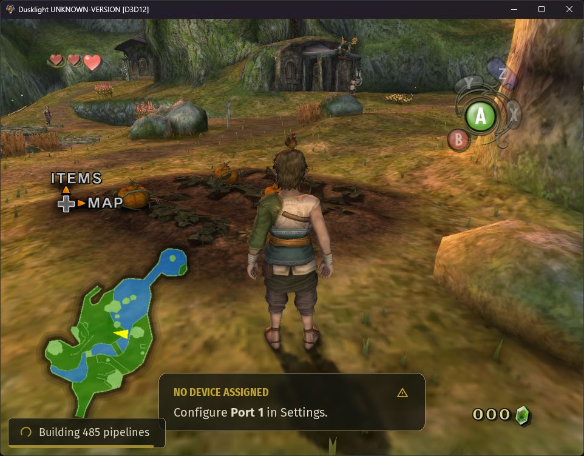

# Texture-colored short grass

The Windows prototype renders short grass in Ordon room 0 using the original
grass image for root color. It is enabled for unset settings and the Remaster
profile. Use **Short grass (Ordon prototype)** or **Vanilla** to disable it.

Greener texture samples grow more clumps with shorter, wider blades. Brown
and gray samples retain sparse blades. The D3D12 follow-up retained 48,000
roots and counted 1,498 visible clumps at the Ordon spawn, compared with
508 in the initial trial. Each clump uses two crossed triangles. The frame
cap is 6,500 clumps, with height fading near the distance limit. The capture
below shows the initial prototype. The desktop was disconnected during the
follow-up, so the denser carpet was verified through runtime counts only.

The first prototype can use the Ordon room 0 terrain model
`F_SP103/R00_00.arc!bmde/model.bmd`. The local asset catalog identifies
`I_kusa` as a 256 × 256 CMPR texture with source hash `6e94ac1fd8d0cb24`.
Material 12, `aa_MA00_kusa_v`, references that texture alongside `I_kumo`.
The model has two signed 16-bit UV streams with 9 and 12 fractional bits.
Material 5 combines grass and dirt, and separate materials use grass-like
textures on walls and vegetation cards. These distinctions give the
prototype a concrete grass surface and useful exclusion cases.

1. Extend the terrain triangle decoder to retain the texture-coordinate
   index at each corner. Confirm which stream and transform feed the
   grass texture in material 12.
2. Scatter short blade clumps deterministically over upward-facing triangles
   of the reviewed material. Sample the grass texture at each root's
   barycentric UV. Use a density mask for blended terrain in a later pass.
3. Render bounded instances after opaque terrain. Use native scene lighting
   and fog, terrain depth for occlusion, and a distance fade for density.
   Keep placement stable as the camera moves. Use original texture identity
   for placement and the resolved image for color when available.

The local replacement inventory has no exact filename candidate for this
Ordon texture. Use the original image for the first proof. Exact color
matching with arbitrary replacement packs needs access to the texture
actually bound by the host, including wildcard or registered replacements.

Compare a fixed route along grass, dirt, and walls. Check root attachment,
edge bleed, shimmer, scene transitions, and GPU duration. The first pass
qualifies one terrain material and one room. Broader coverage can use
reviewed material masks keyed by the existing asset catalog.
