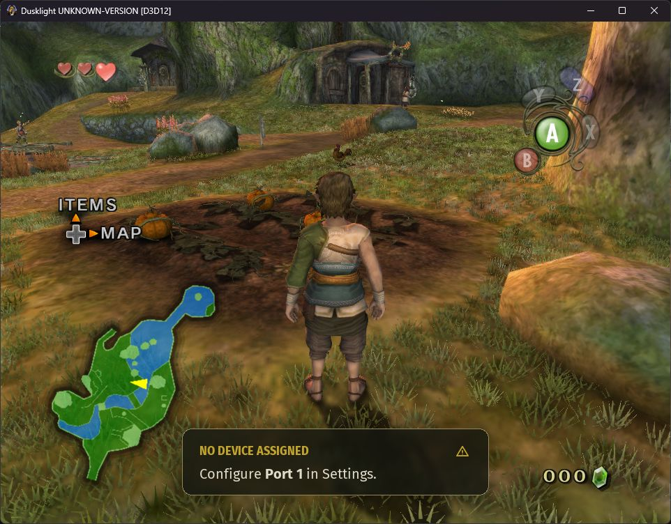

# Texture-colored short grass

The Windows prototype renders short grass in Ordon room 0 using the original
grass image for root color. It is enabled for unset settings and the Remaster
profile. Use **Short grass (Ordon prototype)** or **Vanilla** to disable it.

Greener texture samples grow more clumps with shorter blades. Brown
and gray samples retain sparse blades. The meadow pass uses the projected
footprints of three dirt and path materials to exclude grass, with an 18-unit
margin for blade spread. The Windows trial rejected 240,508 candidate roots
against 189 path triangles. It retained 720,000 roots across the room and
counted 16,065 visible clumps in the first sampled frame. Each clump now uses
nine blades, for 144,585 blades in that frame. Bases are 37.5% narrower and
blades are 25% taller than in the five-blade preview. The GPU
expands each clump from one 48-byte record. The frame cap is 18,000 clumps.

The Windows D3D12 capture shows thicker patches and a clear main trail at the
Ordon spawn. Brown ground remains visible in transitions. The trial closed
with exit code zero. GPU duration and path coverage from other views remain
unmeasured.

The first prototype can use the Ordon room 0 terrain model
`F_SP103/R00_00.arc!bmde/model.bmd`. The local asset catalog identifies
`I_kusa` as a 256 × 256 CMPR texture with source hash `6e94ac1fd8d0cb24`.
Material 12, `aa_MA00_kusa_v`, references that texture alongside `I_kumo`.
The model has two signed 16-bit UV streams with 9 and 12 fractional bits.
Material 5 combines grass and dirt, and separate materials use grass-like
textures on walls and vegetation cards. These distinctions give the
prototype a concrete grass surface and useful exclusion cases.

1. Extend the terrain triangle decoder to retain the texture-coordinate
   index at each corner. Confirm which stream and transform feed the
   grass texture in material 12.
2. Scatter short blade clumps deterministically over upward-facing triangles
   of the reviewed material. Sample the grass texture at each root's
   barycentric UV. Use a density mask for blended terrain in a later pass.
3. Render bounded instances after opaque terrain. Use native scene lighting
   and fog, terrain depth for occlusion, and a distance fade for density.
   Keep placement stable as the camera moves. Use original texture identity
   for placement and the resolved image for color when available.

The local replacement inventory has no exact filename candidate for this
Ordon texture. Use the original image for the first proof. Exact color
matching with arbitrary replacement packs needs access to the texture
actually bound by the host, including wildcard or registered replacements.

Compare a fixed route along grass, dirt, and walls. Check root attachment,
edge bleed, shimmer, scene transitions, and GPU duration. The first pass
qualifies one terrain material and one room. Broader coverage can use
reviewed material masks keyed by the existing asset catalog.
