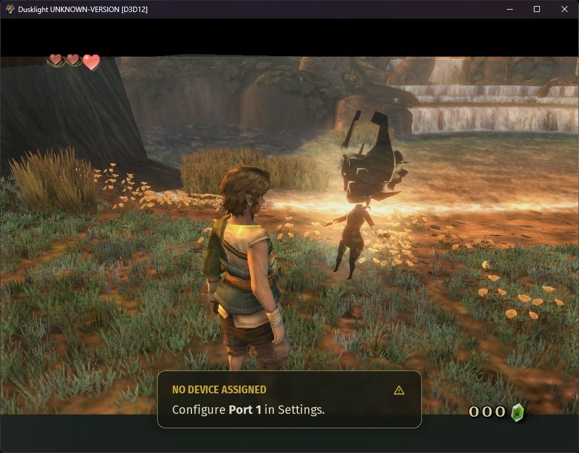
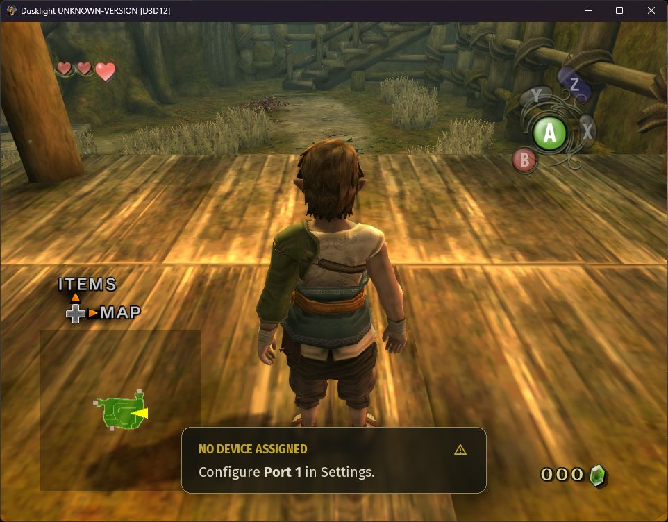
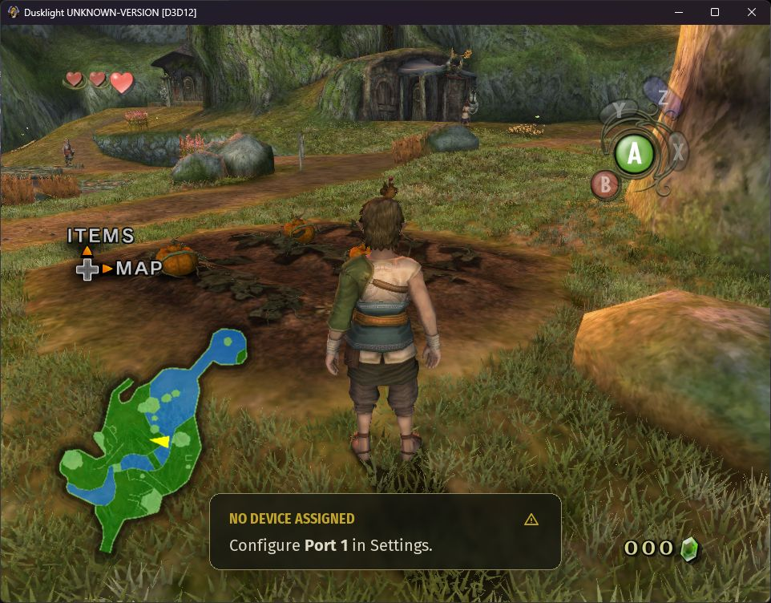
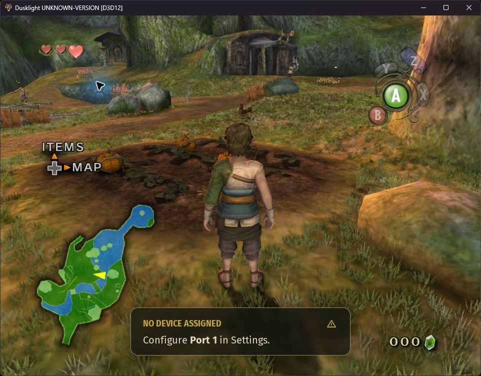
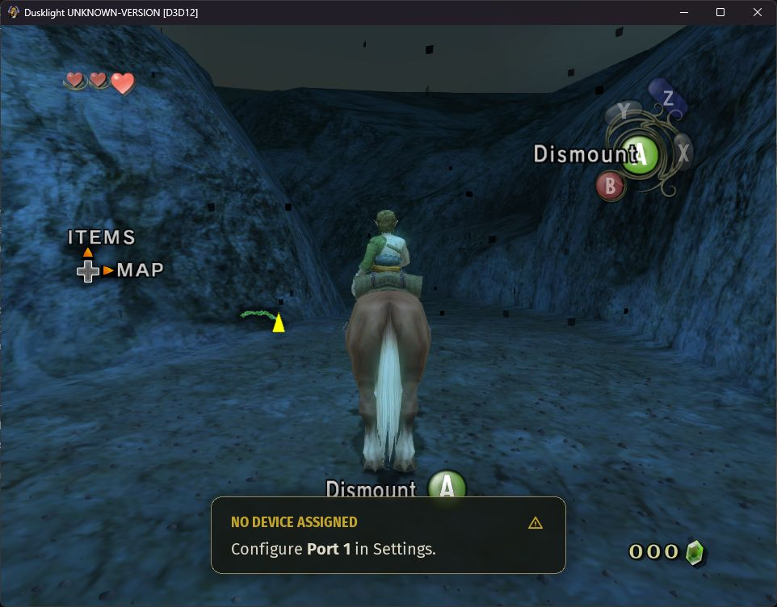

# Texture-colored short grass

Ground cover applies material rules across loaded stage backgrounds, including
real-time cutscenes that render those backgrounds. It is enabled for unset
settings and the Remaster profile. Use **Ground cover (grass, gravel, and
litter)** or **Vanilla** to disable it.

Grass, gravel, forest litter, low plants, and moss use separate placement
rules. The pass checks terrain topology and samples supported original CMPR,
RGB565, RGB5A3, and RGBA8 textures, including external textures loaded by the
stage. Both fixed-point and floating-point terrain UVs are supported. It skips
unqualified materials, animated secondary backgrounds, actor scenery, and
prerendered footage. This is material-based coverage, with no stage allowlist.

Grass tips and low plants bend with the same traveling gusts that move loose
waterfall mist and strengthen fine water ripples. Gusts follow the game's wind
direction and weaken indoors. Grass roots stay planted and path masks still
govern placement. The Windows D3D12 preview exercised the shared effects at
Faron Spring and grass on the daylight Hyrule Field route (room 6).

Green grass surfaces also receive sparse broadleaf and fern-like clumps, using
the same texture-color and path tests. Link and Epona displace grass tips and
plant leaves within a bounded footprint. Roots stay attached to the terrain.
The response follows current actor positions without persistent tracks.

The November 9 open-field follow-up still shows sparse grass across broad
Hyrule Field surfaces. Game-wide qualification is active, but continuous carpet
density is not established there. Epona was repositioned with the native console
for the footprint check; riding through the field remains unverified.

The November 10 correction replaces whole-room root sampling with camera-local
tiles. Each 256-unit tile uses a stable jittered grid and samples the qualified
terrain's original UVs, color, alpha, and path exclusions. Large triangles no
longer get an artificial sample ceiling. The initial cache holds at most 384
tiles, builds up to eight tiles per frame, and renders the nearest qualified
roots first. That initial draw is capped at 28,000 clumps, with gradual density
reduction beyond 650 world units and a 3,400-unit range. The later distance
follow-up below supersedes these cache and range limits. Tiles rebuild
deterministically when revisited.

The new Hyrule Field room 6, entry 2 run logged 19,163 visible clumps after
cache fill. The November 10 Windows D3D12 follow-up shows a dense foreground
carpet at the prior sparse-field comparison camera and after a 594-unit lateral
camera move. Reattaching the gameplay camera also retains dense cover around
Link. A console teleport to the room's trail shows mostly bare dirt with
vegetation along the banks. The detached movement camera intersects terrain
at its destination; that capture establishes local coverage only, not camera
collision quality. These sampled views do not establish whole-map coverage,
riding stability, GPU timing, or uninterrupted streaming at travel speed.

The final trial closed normally with exit code zero. The package SHA-256 is
`5FE46C88577B06B25D7A584594EEBAD75AE62200E8C3E19A1A592BBD3763856F`.
Local captures and logs are in
`build/material-relighting/local-grass-final-field/` (`field-dense.png`,
`field-moved.png`, and `field-path.png`). Topology, preset round-trip, water
identity, and package-contract checks pass for this build. Cache fill after a
warp remains gradual, and distant grass still uses density reduction.

Raised moss now requires an opaque source material. Translucent authored moss
overlays retain their native appearance. The Forest Temple room 3 follow-up
removed generated dark patches from the wooden entrance platform. Solid-surface
moss uses a scalloped cushion instead of three pointed lobes.

## Distant grass coverage

### Recovering movement trails

The November 11 interaction slice adds short-lived bends behind Link and Epona
through the existing Ground cover switch. Near grass and low plants retain a
movement segment after the actor leaves, then ease back toward their wind-driven
pose. Link's segments expire after three seconds and Epona's after 3.8 seconds.
The horse corridor is wider. History is capped at sixteen segments per actor,
so prolonged fast travel can replace old segments sooner.

The CPU evaluates the strongest nearby capsule once per rendered clump, using
separate actor bounds to skip distant histories. A packed bend vector travels
with each instance. The shader combines it with live contact; no history loop
is added per blade vertex. The instance record grows from 48 to 60 bytes.
Distant grass proxies keep their existing rendering without trail memory.
Stone, litter and moss do not deform. There are no collision or persistent
terrain changes.

Stage changes, disable and shutdown clear history. Teleports, large vertical
jumps, missing actors, invalid inputs and long frame gaps prevent false bridges.
The game's pause flag prevents history updates. Vertical distance fades the
effect so another terrain level does not receive a full-strength bend. This is
an actor-position approximation rather than foot/hoof contact simulation.

Motion/recovery and camera/package checks pass. A Windows D3D12 controlled
position probe activates retained bending on 276 nearby clumps and closes with
exit zero. Automated keyboard taps do not register reliably with the native
binding capture, so continuous walking/riding quality remains unverified. See
the [interaction receipt](evidence/grass-trails-2026-11-11/README.md).

### November 11: coverage across the camera view

The renderer now adds a third, coarse grass layer beyond the previous fixed
10,000-unit boundary. Its range accounts for the camera far plane and diagonal
view extent, bounded by loaded eligible terrain and an absolute two-million-unit
limit. Tile size grows in powers of two with that range. The outer layer uses a
24 by 24 jittered grid, up to 192 cached tiles, three tile builds per frame and a
24,000-clump draw budget. It overlaps the middle layer from 6,000 to 8,200 units.
Near and middle layer cache/draw limits remain unchanged.

Tile requests now test the camera view, including a conservative margin and
terrain height bounds. Camera turns, grid movement and FOV/aspect changes refresh
requests. Bounded far draw budgets are shared across tiles with stable shuffled
root order, rather than being exhausted nearest-first. Middle-layer density
falls after 6,500 units instead of 3,200. Distant clumps use broader footprints
and a stable broad lighting response, with enlarged path exclusion margins.
Coarse clump height has a small distance-dependent minimum for visibility.

This extends the carpet appearance using cheaper distant geometry. It does not
render identical close-up blade density everywhere or guarantee every visible
pixel is covered. Texture/material, slope, alpha and route qualification still
apply. Thin or overlapping terrain regions and bounded tile budgets can limit
coverage. Distant enlarged footprints and LOD transitions need further artistic
review; GPU duration, 4K and fast camera travel remain unmeasured.

The Windows D3D12 Hyrule Field trial reports a 149,043-unit view range with
38,365 roots: 16,618 near, 18,420 middle and 3,327 outer. A detached-camera move
also renders normally. The trial closes with exit zero and no logged GPU
validation errors. Camera coverage math and package checks pass. See the
[view coverage receipt](evidence/view-grass-2026-11-11/README.md).

### Previous distance implementation

The range visible in the early field screenshots was camera-centered, rather
than tied to Link. Near grass density reduced beyond 650 world units, rendering
stopped at 3,400 units, and the shared tile budget could shorten coverage further.
Green ground beyond that boundary was not necessarily an unrecognized material.
Material, texture, alpha, slope, and path qualification are still separate
constraints: the pass does not interpret every green screen pixel as grass.

The next November 10 build uses two independent sampling layers. Detailed grass
uses 256-unit tiles with a 36 by 36 jittered grid, a 2,200-unit range, and a
28,000-clump budget. Distant grass uses 1,024-unit tiles with the same grid
resolution, a 10,000-unit range, and a separate 24,000-clump budget. Its sampling
density is sixteen times lower per unit area. Both layers retain original UV
color, alpha, and the same path exclusions. Distant blades are slightly wider,
with a broad diffuse response and no specular highlight to reduce subpixel
facet contrast. The layers overlap between 1,200 and 2,200 units; density and
height fade toward their outer limits.

The near cache holds at most 256 tiles and builds eight per frame. The distant
cache holds at most 384 tiles and builds four per frame. Separate budgets let
both layers fill after a warp without distant work consuming the close-grass
budget. Requests include tiles touching the range circle, rather than testing
only their center. Both caches and both draw budgets remain bounded, so heavily
overlapping loaded rooms can still reduce effective coverage. This is not
unlimited horizon grass. At that checkpoint, plants, stones, and litter retain
their 1,800-unit range; the following plant update extends plants separately.

The final Windows D3D12 field startup logs 37,246 grass clumps: 16,330 near and
20,916 distant. The same camera used for earlier evidence now shows grass
extending into previously flat mid-distance ground. A three-second detached
camera move and a trail teleport retain cover and mostly bare dirt on the
sampled path. Endpoint captures do not establish flicker-free continuous travel.
The final preview closes with exit code zero. Topology, preset round-trip, and
package-contract checks pass, with no logged WGSL or GPU validation errors.
GPU timing, whole-map coverage, and native macOS remain unverified.

The package SHA-256 is
`131381C6F9BA79A15B11C4F3254CA695EB6BE75A1CCF8D3C7AA023305E57DB46`.
Local captures and logs are in
`build/material-relighting/grass-distance-field-final/` (`field-distance.png`,
`field-comparison.png`, `field-moved.png`, and `field-path.png`). The earlier
`grass-distance-field` trial is the coarse calibration build.

## Low plant range and retention

The next November 10 update gives broadleaf and fern-like plants a separate
12,000-sample reservoir per background part and a 6,000-clump visible budget.
Gravel and litter no longer compete with plants for retained samples. The
existing 24,000-sample stone/litter reservoir and its draw cap remain separate.
Plants now render to 5,200 world units rather than 1,800. Their deterministic
density reduction begins beyond 2,000 units, and their size fades through the
last 1,200 units. The same material, texture-color, slope, alpha, and path tests
still govern eligibility. Wind, actor displacement, and scene lighting use the
existing plant shader without another draw pass or setting.

Windows D3D12 field startup logs 18 plants, compared with seven in the previous
build's same entry view. Grass retains the previous 37,246-clump count. The Faron
real-time dialogue preview logs 105 plants, 260 leaves, 81 twigs, and 8,275 grass
clumps. Both previews close normally with exit code zero and no logged WGSL or
GPU validation errors. Topology, preset round-trip, and package-contract checks
pass. The Faron capture still shows the previously observed horizontal mist
boundary. The subsequent [water replay correction](water-scene-reflections.md#november-10-water-replay-correction)
resolves that artifact and the related letterbox spill. Plant
transition quality during continuous travel, GPU cost, whole-map quality, and
native macOS remain unverified.

The package SHA-256 is
`B2C127F6F77B7C24B0021E19E2ACA0BB98B6057D15091CA4BDE2C527BFF0ABE6`.
Local screenshots and logs are in
`build/material-relighting/plant-distance-field/` (`field-plants.png`) and
`build/material-relighting/plant-distance-faron/` (`faron-plants.png`).

## Scene lighting for generated cover

The November 10 follow-up lights all generated cover from its deformed triangle
normals. Grass, leaves, and low plants use a two-sided diffuse response; stones
use opaque diffuse shading and a restrained broad highlight. Twigs and moss
retain a matte response. Existing root darkening and shape variation remain.
The shared path applies to every qualified background, including background
geometry rendered during real-time cutscenes, without new stage identities.

Outdoor illumination uses native sun color, position, and strength, plus native
background ambient color and sky brightness/tint. The native base light is
initialized white even at night, so it cannot supply outdoor sunlight strength.
Interiors use a subdued base-light response and background ambient color.
Twilight tint applies to grass as well as other generated details. Native fog
now blends after lighting, rather than receiving extra surface shading.

Windows D3D12 field captures at noon and midnight show the lighting change
without changing placement. The final field trial logs 19,163 grass clumps and
seven plants. The Eldin room 7 trial shows 735 stones in its fixed blue Twilight
environment; changing the clock does not turn that environment into daylight.
Both final trials close with exit code zero and no logged WGSL or GPU validation
errors. Topology, preset round-trip, and package-contract checks pass.

The final package SHA-256 is
`B90A1920F57ED0F4E81798518177B40B027178911F724AAE7AF7655348DA767C`.
Local evidence is in `build/material-relighting/ground-lighting-field-sun/`
(`field-noon.png`, `field-midnight.png`) and
`build/material-relighting/ground-lighting-eldin/` (`eldin-gravel.png`). Earlier
`ground-lighting-field` and `ground-lighting-field-final` trials are calibration
builds, not the final package. Interior lighting, individual litter classes,
moving-camera highlights, GPU cost, and native macOS remain unverified.
This is lighting for added ground geometry; authored roughness/normal maps and
broader original rock, bark, cloth, and metal response remain separate work.

The Windows D3D12 preview showed grass and forest-floor scatter during
Faron's real-time Midna dialogue and preserved the prior spawn counts in
Ordon and Eldin. Adjacent loaded rooms also qualified in Faron and Eldin.
The detail pass adds curled leaves, tapered twigs with offshoots, raised
broadleaf plants, and low, overlapping moss patches. Plants favor greener
forest-floor samples. Moss follows qualifying rock and moss textures, including
Forest Temple ground. Grass and forest detail respect recognized path masks.
The Faron cutscene sample counted 402 leaves, 142 twigs, and 26 plants. The
Forest Temple room 3 sample counted 927 moss patches. Full-map coverage and
GPU timing remain unverified.

## Ordon baseline

The denser carpet pass raises the visible budget to 28,000 clumps and keeps
greener terrain denser and wider than brown transitions. Narrower triangle
insets reduce gaps between faces. Grass is grouped into tiles so distant
roots can be skipped together. The Ordon Windows preview reached the
28,000-clump budget at spawn and kept the main trail clear of grass.

Greener texture samples grow more clumps with shorter blades. Brown
and gray samples retain sparse blades. Stable terrain-space patches vary
clump height and break up density in transitions. Each blade varies in
direction, spread, and height. The meadow pass uses the projected
footprints of three dirt and path materials to exclude grass, with an 18-unit
margin for blade spread. The Windows trial rejected 240,595 candidate roots
against 189 path triangles. It retained 720,000 roots across the room and
counted 16,078 visible clumps in the first sampled frame. Each clump uses
nine blades, for 144,702 blades in that frame. The GPU
expands each clump from one 48-byte record. The frame cap is 18,000 clumps.

The Windows D3D12 capture shows thicker patches and a clear main trail at the
Ordon spawn. Brown ground remains visible in transitions. The trial closed
with exit code zero. GPU duration and path coverage from other views remain
unmeasured.

## Gravel and pebbles

The same ground cover pass adds small stones to Ordon room 0 dirt and path
materials and Eldin Field rooms 7 and 9 gravel material. The mesh follows
the terrain slope, samples color from the original material texture, and
uses ambient light, Twilight tint, and fog. Path material gets a lower
scatter rate than dirt or gravel. Steep triangles and transparent or green
texture samples are excluded. The stones are decorative and add no collision.

Windows D3D12 startup captures counted 44 visible pebbles in Ordon and 735
and 892 in Eldin rooms 7 and 9 respectively. All three trials closed cleanly.
Room transitions and GPU timing were outside this check.

## Grass prototype qualification

The first prototype can use the Ordon room 0 terrain model
`F_SP103/R00_00.arc!bmde/model.bmd`. The local asset catalog identifies
`I_kusa` as a 256 × 256 CMPR texture with source hash `6e94ac1fd8d0cb24`.
Material 12, `aa_MA00_kusa_v`, references that texture alongside `I_kumo`.
The model has two signed 16-bit UV streams with 9 and 12 fractional bits.
Material 5 combines grass and dirt, and separate materials use grass-like
textures on walls and vegetation cards. These distinctions give the
prototype a concrete grass surface and useful exclusion cases.

1. Extend the terrain triangle decoder to retain the texture-coordinate
   index at each corner. Confirm which stream and transform feed the
   grass texture in material 12.
2. Scatter short blade clumps deterministically over upward-facing triangles
   of the reviewed material. Sample the grass texture at each root's
   barycentric UV. Use a density mask for blended terrain in a later pass.
3. Render bounded instances after opaque terrain. Use native scene lighting
   and fog, terrain depth for occlusion, and a distance fade for density.
   Keep placement stable as the camera moves. Use original texture identity
   for placement and the resolved image for color when available.

The local replacement inventory has no exact filename candidate for this
Ordon texture. Use the original image for the first proof. Exact color
matching with arbitrary replacement packs needs access to the texture
actually bound by the host, including wildcard or registered replacements.

Compare a fixed route along grass, dirt, and walls. Check root attachment,
edge bleed, shimmer, scene transitions, and GPU duration. The first pass
qualifies one terrain material and one room. Broader coverage can use
reviewed material masks keyed by the existing asset catalog.
