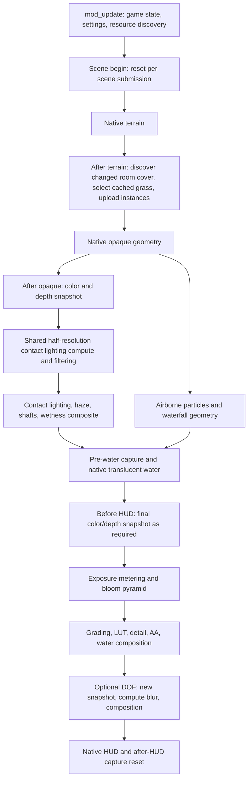

# Local performance engineering, November 12, 2026

## Baseline and scope

The authoritative starting point is the dirty `codex/m12-water` working tree at
`2cd2858`, not the published 1.22.0 package. The initial status and SHA-256 hashes
of preexisting edits are in [workspace-baseline.json](evidence/performance-2026-11-12/workspace-baseline.json).
These include grass trails, view-dependent distant grass, airborne particles,
surface profiles, and the richer Natural lattice. Existing edits to host patches
are outside this program's changes. No host sources, host patches, remotes, or
release state are changed by this work.

## Execution architecture



This shows dependencies, not GPU timing. Same-stage hooks depend on registration
order; `ambient_occlusion::apply` can also be called by the final renderer's
capture hook, with a per-scene `submitted` guard preventing duplicate submission.
Native water capture is coordinated by `water_probe`, including thickness
finalization before final composition. A snapshot from before a composition
cannot replace one from after it without changing the image.

The producer uses supported graphics-service calls to append commands. The render
worker subsequently encodes draw/compute callbacks. Service synchronization in
`upstream/dusklight/src/dusk/mods/svc/gfx.cpp` uses `AuroraGXSync`; this establishes
recording order, not evidence of GPU completion. Snapshot views and uniform/vertex
ranges are borrowed, frame-scoped host resources. Compute callbacks borrow the
frame encoder and cannot finish or release it. Presentation and simulation cadence
remain host responsibilities. A 30 Hz simulation or presentation cap does not
establish GPU headroom.

### CPU and resource cost model

| System | Each update/frame | On resource/layout change | Lifetime and invalidation |
|---|---|---|---|
| Settings, game/camera state | Twilight interpolation, controls and native environment queries; diagnostics gated | Config registration and preset storage | Mod lifetime; timing windows reset explicitly |
| Geometry/asset probe | Hooks, identity lookup, bounded discovery, optional diagnostics | Decode topology, qualify/rebuild normals, replacement correlation | Resource-owner erase hooks and shutdown restore original data; existing work preserved |
| Material relighting/profiles | Toggle request only on change; bounded startup discovery | Cache authored finish classifications | Optional service only; missing service preserves fallback; resource ownership clears profiles |
| Ground cover | Actor enumeration, identity checks, reach scan, culling, trail response, clump assembly and vertex upload | Scatter one changed room part per frame; deterministic tiles built with separate budgets of 8/4/3 | Room/model/stage/toggle invalidation; unused tile roots evicted per epoch; all cover freed at shutdown |
| Grass request selection | Rebuilt on revision, camera cell, direction, FOV or aspect change; stable distance sort and caps 256/384/192 | New terrain index built alongside surfaces | Index owns bounds/indices only and resets with its RoomCover |
| Grass GPU | One batched procedural draw; up to 9 triangle blades/clump, plus distant layers and details | Pipeline keyed by layout/reversed depth | Streamed instance data; shader wind stays GPU-side; draw counts and density unchanged |
| Water/falls | Render-cadence identity scan and native environment; procedural waterfall/contact geometry | Classification and model transforms invalidate discovery | Pre-water color/depth and mask are frame-scoped; no cross-frame view cache |
| Shared lighting | 3040-byte uniform, color/depth snapshot, half-resolution compute/filter when contact effects active, fullscreen composite | Targets by size and indirect-light requirements; fog height grid cached by room and snapped position | Owned target sets with pending-command retirement; source views remain frame-scoped |
| Final grading | Nonneutral enabled path resolves once and draws; disabled/neutral bypass precedes layout/resolve | Pipelines and two 33-cube RGBA16F LUTs per layout | Cached until shutdown; resizing same layout avoids pipeline rebuild |
| Natural palette | Existing trilinear LUT sampling, Twilight blending when needed | Recent richer transform computed during lattice construction | No extra pass or full-resolution target from recent palette edits |
| Exposure | One 1x1 metering dispatch plus existing final composition | History reset on scene/layout/toggle change | Two alternating history textures plus neutral texture, each 1x1 RGBA16F |
| Bloom | Quarter-resolution prefilter and separable blur, downsample/upsample pyramid; `3+2*(levels-1)` dispatches | Two RGBA16F images per pyramid level, up to five levels | Size-dependent sets; pending counts protect queued work; final composite releases its reference |
| DOF | Separate post-grade snapshot, half-resolution blur/reconstruction and fullscreen composition | Target allocation on size change; layout pipeline cache | Independent focus history; disable/invalid camera bypasses |
| Airborne | Select nearby vegetation anchors, animate and upload bounded sprites | Pipeline creation on layout change | Reuses CPU vertices; current anchor candidate vector is temporary |

There are no mod-local GPU waits added here. Pipeline creation, validation scopes,
scatter, and fog-grid rebuilds can produce startup/transition tails. Those require
separate cold and warm measurements. The older statement in `performance.md`
about no per-frame heap allocations described the original final grading stage,
not today's vegetation/water/particle callbacks. Temporary tile lists and airborne
candidate vectors are concrete examples in the current code.

### Observability and critical-path limits

Existing `renderer` diagnostics provide optional callback/latest-layout/latest-resolve
CPU durations and rolling p50/p95; `tools/frame-timing.py` provides p50/p95/p99 for
previously captured producer/present wall spans. The latter capture mechanism is
an existing optional host experiment, not a required or newly extended integration.
GPU pixel fixtures exercise shaders on D3D12; Null-backend compilation is separate.

Neither CPU submission timers nor those pixel-test durations measure GPU execution.
The graphics service has no built-in per-effect timestamps. Direct encoder queries
would additionally require timestamp feature negotiation and query-result lifecycle
support; merely obtaining an encoder is insufficient. External D3D12 GPU captures
(PIX or an applicable vendor profiler) remain the next option on this machine.
No external GPU capture was collected for this program. Native frame-time p50/p95/p99,
CPU-vs-GPU-vs-presentation limiting factors, register pressure, occupancy, physical
memory traffic, and game-wide allocation counts remain unestablished.

## Ranked backlog

Evidence levels below distinguish demonstrated algorithm costs from hypotheses.
All eligible candidates must ship as an ordinary MidnaFX mod.

| Rank / status | Opportunity and evidence | Benefit / confidence | Complexity / risk | Dependencies and validation |
|---|---|---|---|---|
| 1 / retained | Grass tile requests perform repeated linear scans over immutable surface bounds | Large synthetic CPU query improvement; high confidence for spread terrain, game-frame benefit unknown | Small bounds hierarchy; extra CPU memory and build work; no pointer cache | Exact boolean parity, boundary/unload tests, paired workload benchmark; runtime smoke separately |
| 2 / retained | Three returned temporary tile vectors allocate every populated frame | Removes warmed list allocation churn; exact allocation model | Low; retains at most high-water pointer capacity | Same order/counts; clear borrowed pointers on every stage exit, release storage at shutdown |
| 3 / retained | Reach repeats `hypot` for shared vertices and unchanged camera XZ | Native reach p50 53.7–54.25 us to 0.4 us in three pairs | Owned deduplicated XZ points and exact-input cache; original arithmetic retained | Bitwise numeric/movement/invalidation tests and native input parity; see continuation receipt |
| 4 / deferred | Tile generation scans all surfaces/paths again for each new tile | Potential traversal-tail reduction; source evidence | Medium; RNG consumption and surface order must remain exact | Reuse index with results sorted in source order, benchmark real cold tile generation before retaining |
| 5 / retained | Airborne candidates rescan terrain and allocate/sort while inputs are unchanged | Native selection p50 162.5–168.7 us to 0.2 us in three reversed pairs | Bounded copied-value cache; no changes to animation or sorting on misses | Exact camera/revision/request-count keys, ordered source hashes, source-cache unit tests; see round-four receipt |
| 6 / retained for exact stationary inputs | Assembly rebuilds unchanged instance geometry | Large settled-camera CPU saving; transition windows have mixed tails | Reuse owned clump vector only with ready tiles and exact camera/terrain key; refresh live trails | Original cache-miss loop preserved; key/trail tests, cached-frame geometry hashes and fresh paired native runs |
| 7 / deferred | LUTs and all pipeline variants are eagerly created per layout | Potential startup and resident-memory reduction; source evidence | Medium; lazy creation can move stalls into active frames | Record startup/layout times, include Neutral/default Natural and toggles; warm alternatives outside stage |
| 8 / deferred | Bloom intermediate reuse or shared-memory filtering | Possible GPU/bind-group savings; not measured as a bottleneck | Medium/high; blur distribution, precision, occupancy, pending ownership | GPU captures, impulse/image tests, resize/reload and low-end paired runs |
| 9 / deferred | More contact-lighting fusion/reconstruction reuse | Already shares compute/composition; marginal benefit unknown | High; register pressure and bypass behavior | Per-effect GPU timestamps/captures before further fusion |
| 10 / deferred | Ground fog rebuild probes 144 native cells when snapped camera cell changes | Potential traversal tail; source evidence | Medium; incremental grid must preserve collision/room invalidation | Native traversal trace, height-grid equality, room transition checks |
| blocked | Zero-copy in-place final scene feedback or moving host resolve synchronization | Not exposed by supported mod interface | Host-boundary blocked | Do not implement via host patches or undocumented hooks |
| blocked | Native material shader-loop/streaming/decompressor redesign | Actual code belongs to host/Aurora; optional bridge already exists | Host-boundary blocked | Keep current bridge compatibility; no new host requirement |

No GPU algorithm replacement was retained without GPU measurements. Further grass
generation/culling changes are deferred until native traces can rank their impact
against the unchanged vertex upload, overdraw and shared post-processing costs.

## Benchmark and regression procedure

Build `terrain_index` in Release and run it without competing builds, tests, game
instances, or power-policy changes:

```powershell
python tools/performance-bench.py --executable build/windows-release/tests/Release/terrain_index.exe --hardware docs/evidence/performance-2026-11-12/hardware.json --output build/performance-current.json
python tools/performance-bench.py --input build/performance-current.json --output build/performance-summary.json
```

The second command accepts raw benchmark JSON or a saved runner report. To compare
history, pass `--reference` with the previous
runner report and the same `--hardware` metadata. Trend ratios are informational,
never a strict shared-runner CI timing gate. Functional `terrain_index` tests are
part of normal CTest; the expensive benchmark runs only with `--benchmark`.

Each workload has two warmups and twelve paired AB/BA trials. A batch performs
24,300 tile queries at three layer sizes with the original inclusive bounds and
frustum predicate. Tiny terrain, spread terrain, and fully overlapping terrain
are all retained. These are deterministic synthetic geometries, not native scene
captures. Batch percentiles describe repeated CPU workloads, not individual game
frame percentiles. The report records all trials, paired ratio range, p50/p95/p99,
index allocation capacity, build time, executable/source hashes, and dirty HEAD.
Index build time is a single cold observation and has no distribution claim.

The tile-list benchmark separately counts allocation/free operations for the same
three vector sizes (256/384/192), across 1000 frames. It is explicitly an allocation
model, not intercepted game-wide heap telemetry. It includes warmup allocations
and final storage release. No GPU duration is represented by these CPU results.

### Native measurement matrix and budgets

| Dimension | Planned controlled comparison | Status / required evidence |
|---|---|---|
| Configuration | No mod, Vanilla, individual features, full Remaster | Current evidence is mod-local CPU; native configuration comparisons remain open |
| Resolution | 1920x1080, 2560x1440, 3840x2160 | Must record actual render size/scale; no inferred GPU results |
| Scene | Ordon/outdoor, Faron/vegetation, indoor/dungeon, lake/water | Fixed save/camera/time/weather and scene ID; smoke coverage recorded separately |
| Motion | Static, camera pan, traversal | Warm paired reversed order; separately retain transition/stall outliers |
| Assets | Original, supported replacements | Record pack revisions and hashes; do not substitute original-texture results |
| Lifecycle | Startup, scene transition, reload, resize, shutdown | Separate cold timings and resource errors; automated CPU index invalidation is narrower |
| Platform | Existing Windows D3D12 host; Intel Mac best effort | Record binary hash and optional integrations; Metal unavailable here |

Use at least three reversed paired runs per native case, identical host, driver,
settings, render scale, scene and capture window. Warm shaders/resources first and
report warmup duration. Reuse existing frame-timing analysis only with genuine
captures. Preserve failed runs and their reasons. Derive a regression threshold
from repeated reference-machine variance; investigate changes beyond both a
practical time budget and the observed noise band. Do not set a universal timing
gate from this synthetic test.

For a presentation target F, the total frame envelope is 1000/F ms (16.67 ms at
60 Hz; 33.33 ms at 30 Hz). Incremental MidnaFX headroom is that envelope minus the
measured baseline game GPU/CPU critical path and a measured tail reserve. Allocate
budgets for base overhead, shared lighting, bloom, exposure, relighting, water,
vegetation, CPU callbacks, resident memory and transition/reload latency only after
reference-machine captures. Those per-system numeric budgets remain **unassigned**.
The historical 0.25 ms basic-grade 4K target remains aspirational, not achieved.
The known new CPU index memory and bounded pointer retention are accounting
controls; they are not measured total-process residency budgets.

## Optimization ledger and implementation report

The detailed results, validation outcomes, risks, and retained/reverted decisions
are recorded in the [run receipt](evidence/performance-2026-11-12/README.md).
No shader, quality setting, density, material semantics, timing, or game mechanics
changed. Frame-time variance and GPU improvements remain unmeasured. This program
stops at the current measurement boundary rather than accumulating speculative
GPU rewrites. The remaining ranked work has explicit evidence requirements above.

## Native CPU continuation

The [continuation receipt](evidence/performance-2026-11-12/round2/README.md)
extends this audit with native grass CPU capture and exact reach/geometry reuse.
It separates native camera/FOV settling from steady state and retains incomplete
and unfavorable trials. The existing diagnostics toggle arms a bounded
384-sample capture; disable or clear cover to reset it. `mod_update` emits one
JSON batch after capture. Diagnostics off takes no capture clock readings.

Captured producer wall spans cover reach, request selection, tile work, assembly
and submission. Discovery, proof hashing, serialization, host simulation,
render-worker execution, GPU completion and presentation are outside these spans.
They are not GPU or whole-frame timings. `tools/grass-native-bench.ps1` runs
isolated paired packages, records hardware/hashes and normal-close status, and
rejects incomplete captures. `tools/grass-cpu.py` reuses established percentile
semantics and reports means, percentiles, paired ratios and geometry proofs.

The final native validation declares a 288-sample warmup and uses the last 96
samples. The exploratory 128-sample warmup did not finish native FOV settling;
those mixed-window results and unfavorable tails remain in the receipt. Choose
warmup before comparing candidates and verify the intended camera/motion state.
The geometry cache keeps CPU trails and current GPU uniforms live. Any relevant
camera/lens/reach, terrain revision or room-priority change, or incomplete tile
generation, takes the original assembly loop.

The [instance-upload continuation](evidence/performance-2026-11-12/round3/README.md)
now reuses the complete unchanged instance buffer after eight stable frames.
Per-instance CPU trail bits are checked exactly; geometry or trail changes use
the original stream. Shader source, vertex layout and live uniforms remain
unchanged. Pending commands pin immutable snapshots; WebGPU reference retirement
protects encoded work. Native paired measurements and D3D12 byte/lifetime tests
support retention. Added owned GPU storage and activation cost are recorded in
the receipt. Dynamic attribute splitting remains deferred. GPU capture and
discovery profiling should now rank further changes before more CPU cache work.

The [airborne-source continuation and integration qualification](evidence/performance-2026-11-12/round4/README.md)
measured discovery at about 11 us and source selection at about 161 us before
choosing the latter. It caches only the ordered source values for exact camera,
terrain and requested-count matches; live particle animation remains per-frame.
The complete local implementation is authorized for merge to main and origin.
Historical failed surface-map checks remain in earlier receipts; current tests
now distinguish the absent host experiment from shipped functionality and reject
unsupported pixel-test flags explicitly.

GPU observability was checked against local Aurora again. Its existing
`webgpu/gpu_prof.cpp` integration requires `TRACY_ENABLE`; local `webgpu/gpu.cpp`
requests TimestampQuery only under that build flag. The working host cache has
`TRACY_ENABLE=OFF`, and native logs list enabled features without TimestampQuery.
No host source or build configuration was changed to enable it. External GPU
capture remains the next supported measurement route on this executable.
